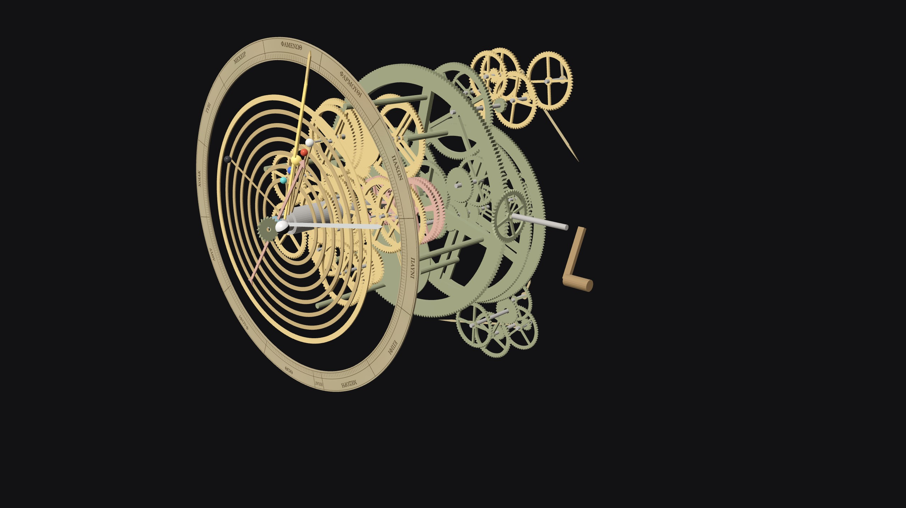
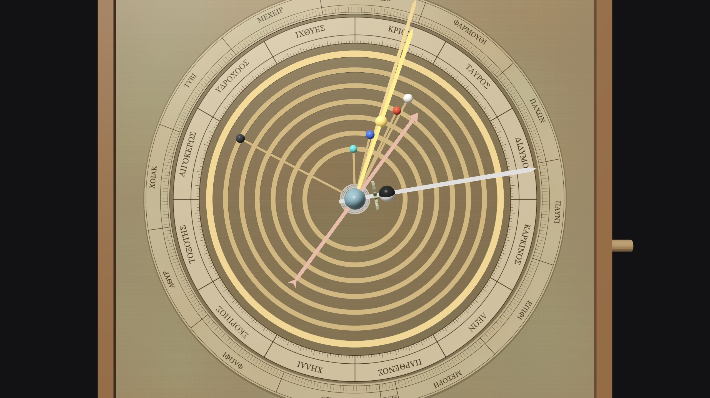
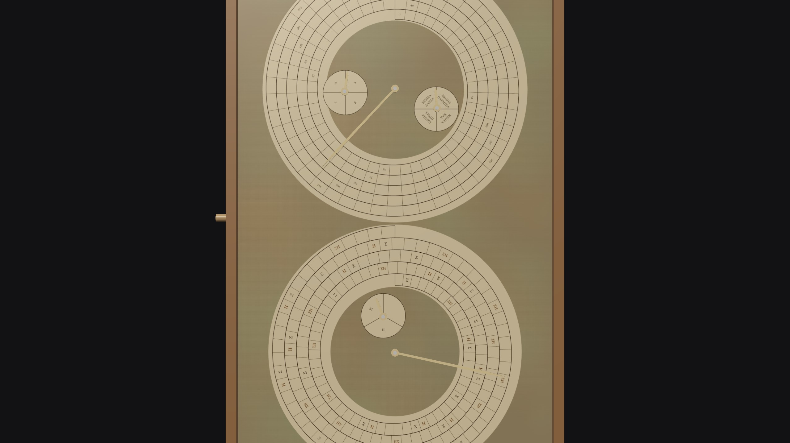
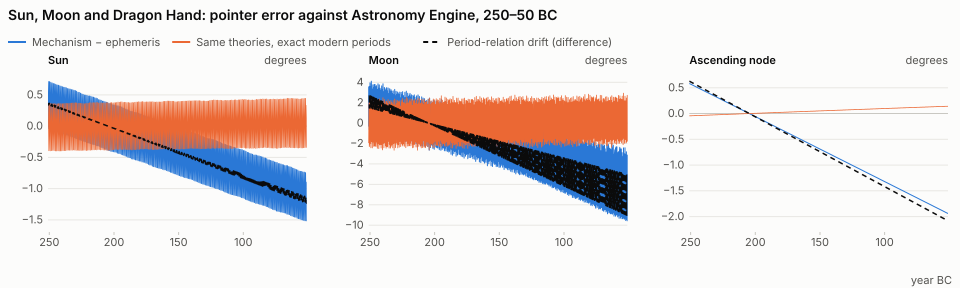
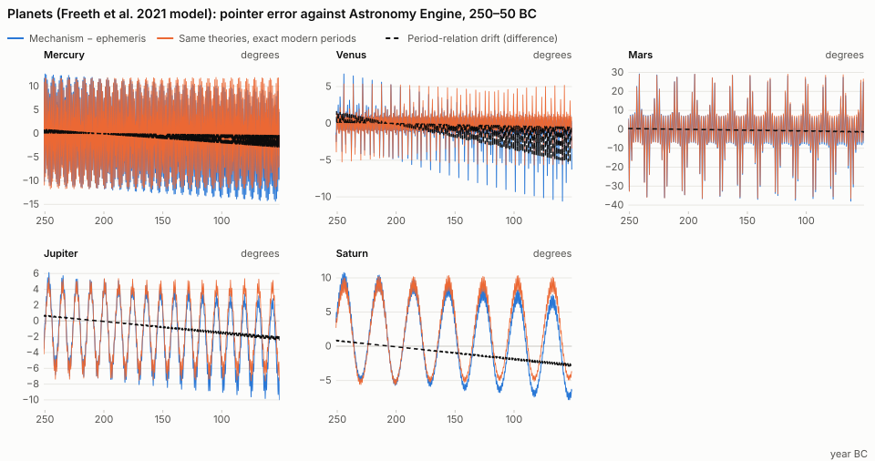
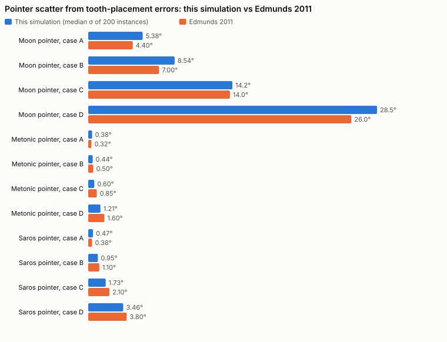

# Antikythera

An interactive 3D reconstruction of the Antikythera mechanism in the browser, with its astronomy checked against a modern ephemeris. Every gear is driven by exact rational kinematics. Every tooth count comes from the published reconstruction, and each gear is marked as surviving or reconstructed. The mechanism's predictions are then compared with where the Sun, Moon and planets actually were from 250 to 50 BC, and with the eclipses that actually happened.

**[Open the mechanism](https://ylfeid.github.io/antikythera/)** (needs WebGPU)



 

## The mechanism

The Antikythera mechanism was recovered in 1901 from a shipwreck of about 60 BC off the island of Antikythera. It survives as 82 corroded bronze fragments containing 30 gears, about a third of the original. It was a hand-cranked calculator. On the front, pointers and rings showed the positions of the Sun, Moon and planets on the zodiac, the phase of the Moon and the date in the Egyptian calendar. On the back, two spiral dials counted the months of the 19-year Metonic calendar and of the 223-month Saros eclipse cycle, with subsidiary dials for the four-year games cycle, the 76-year Callippic cycle and the eclipse-time correction of the Exeligmos.

Price (1974) first reconstructed much of the gearing from radiographs. X-ray CT in 2005 resolved the gearing behind the main wheel and revealed thousands of characters of inscription (Freeth et al. 2006, 2008). The planetary display at the front, where almost all the gears are lost, was reconstructed by Freeth et al. (2021) from the inscriptions and from features on the main wheel. This project follows those papers.

## Gear trains

The input is the crank. Its contrate gear a1 (48 teeth) turns the main drive wheel b1 (223) once per year; everything else is driven from b1. All ratios below are computed by the code from the tooth counts, not typed in. `~` means "meshes with", `+` "on the same arbor", and `⊕` "pin-and-slot".

| Output | Train | Exact ratio (turns per year) | What it is |
| --- | --- | --- | --- |
| Moon (sidereal) | b2 ~ c1 + c2 ~ d1 + d2 ~ e2 + e5 ~ k1 ⊕ k2 ~ e6 + e1 ~ b3 | (64/38)·(48/24)·(127/32) = 254/19 | 254 sidereal months in 19 years |
| Lunar apsides | b2 ~ l1 + l2 ~ m1 + m3 ~ e3 | (64/38)·(53/96)·(27/223) = 477/4237 | carrier of the pin-and-slot; one turn in 8.88 years |
| Lunar anomaly | e5 relative to e3 | 254/19 − 477/4237 = 56165/4237 | anomalistic months, 27.554 days |
| Moon phase | b3 − b0 through contrate ma1 | 254/19 − 1 = 235/19 | 235 synodic months in 19 years |
| Metonic dial | b2 ~ l1 + l2 ~ m1 + m2 ~ n1 | (64/38)·(53/96)·(15/53) = 5/19 | 5 turns of a 235-month spiral |
| Callippic dial | n3 ~ p1 + p2 ~ q1 | (5/19)·(15/60)·(12/60) = 1/76 | 76 years = 27,759 days |
| Olympiad dial | n2 ~ o1 | (5/19)·(57/60) = 1/4 | the four-year games cycle |
| Saros dial | m3 ~ e3 + e4 ~ f1 + f2 ~ g1 | (477/4237)·(188/53)·(30/54) = 940/4237 | 4 turns per 223 months |
| Exeligmos dial | g2 ~ h1 + h2 ~ i1 | (940/4237)·(20/60)·(15/60) = 235/12711 | one turn per 3 Saros (669 months) |
| Dragon Hand (nodes) | 49 ~ 62 + 64 ~ 48 on b1 | 1 − (49·64)/(62·48) = −5/93 | backwards once in 18.6 years |
| Mercury | 51 ~ 72 + 89 ~ 40 ~ 20 ⊕ follower | (51/72)·(89/20) = 1513/480 synodic | 1513 = 17·89 synodic cycles in 480 years |
| Venus | 51 ~ 44 + 34 ~ 26 ~ 63 ⊕ follower | (51/44)·(34/63) = 289/462 synodic | 17² in 2·3·7·11 years; 462 is read on the Front Cover Inscription |
| True Sun | 56 ~ 52 ~ 56 ⊕ follower | the last 56 stands still in space | Hipparchus' eccentric solar orbit |
| Mars | 56 ~ 64 + 38 ~ 40 ~ 71 ⊕ 80 ~ 80 | (56/64)·(38/71) = 133/284 synodic | output 151/284 turns per year |
| Jupiter | 56 ~ 64 + 45 ~ 40 ~ 43 ⊕ 65 ~ 65 | (56/64)·(45/43) = 315/344 synodic | output 29/344 |
| Saturn | 56 ~ 52 + 61 ~ 40 ~ 68 ⊕ 86 ~ 86 | (56/52)·(61/68) = 427/442 synodic | 442 is read on the Front Cover Inscription; output 15/442 |

Three mechanisms are worth describing in words.

In the lunar anomaly mechanism, e5 and k1 have 50 teeth each, and so do k2 and e6. k1 and k2 ride on e3, on axes 1.1 mm apart. A pin on k1 drives a slot in k2, so k2 runs fast and slow once per turn relative to e3. The output is therefore the mean sidereal Moon plus a ±6.53° oscillation. Because e3 turns with the Moon's line of apsides, that oscillation has the period of the anomalistic month. The device reproduces the Greek epicycle theory of the Moon exactly (Carman, Thorndike & Evans 2012, verified in the tests).

For the inferior planets, the epicyclic gear turns at the synodic rate relative to b1. A pin on it, at distance d = p·i from its centre, is followed by a slotted arm that pivots on the central axis. Here p is the planet's distance from the Sun in AU and i is the gear's distance from the centre, so the arm points along mean Sun plus heliocentric planet, which is the deferent and epicycle.

The superior planets use indirect mechanisms on the Circular Plate, after the lunar device. A pin gear turning at the synodic rate drives a slot gear on an axis offset by o, and an equal gear reverses the motion onto the output tube. Freeth et al. prove with two "mirrors" that the output is the planet's epicyclic longitude. The tests check that the angles agree to within 10⁻⁸ degrees. Offsets and pin distances are from Supplementary Table S9 of Freeth et al. 2021.

## What survives and what is reconstructed

69 gears in all: 30 surviving, 39 reconstructed. Surviving gears are drawn in patinated bronze, reconstructed ones in brass, and the speculative Dragon Hand in copper. Setting reconstructed parts to hide shows only what is in the fragments. Clicking any gear shows its evidence, sources, measured radii and exact rate.

| | Gears | Evidence |
| --- | --- | --- |
| Surviving | a1, b1–b3, c1–c2, d1–d2, e1–e6, f1–f2, g1–g2, h1–h2, i1, k1–k2, l1–l2, m1–m2 (Fragment A); o1 (B); ma1 (C, the moon-phase contrate gear); the 63-tooth gear of Fragment D | Tooth counts from CT (Freeth et al. 2006, 2008); radii and thicknesses from Freeth et al. 2021, Supp. Table S8 |
| Reconstructed, required | m3, n1–n3, p1–p2, q1 | Lost, but the dials they drive survive and need exactly these ratios |
| Reconstructed, modelled | Mercury, Venus, true Sun, Mars, Jupiter, Saturn, b0 | The functions are described in the inscriptions; the gearing is Freeth et al.'s 2021 reconstruction. Fragment D's 63 is surviving, but its role as the Venus epicycle is their interpretation |
| Speculative | Dragon Hand (49, 62, 64, 48) | "No direct physical evidence" (Freeth et al. 2021); included because it fits the bearing on spoke B |

Where the sources disagree or are uncertain:

- b1 is counted as 223 in the 2021 Table S8; 224 has also been proposed. It meshes only with the crank, so no output depends on it.
- The Mercury idler: Freeth et al. 2021 give the Mercury train as 51 ~ 72 + 89 ~ 40 ~ 20 in Fig. 3e, but "40 ~ 24" in the caption of Supp. Fig. S22. Only 20 gives the stated 1513/480, so 20 is used.
- The Egyptian calendar ring is drawn with 365 days, as in the 2021 model. Statistical hole counts (Budiselic et al. 2020; Woan & Bayley 2024) favour 354, which would make it a lunar calendar.
- The orientation of the moon-phase contrate gear is debated (Freeth et al. 2021, Supp. §6.2.4).
- The superior planets and the true Sun have no surviving gearing at all.

## Accuracy, 250–50 BC

The mechanism is compared with [Astronomy Engine](https://github.com/cosinekitty/astronomy): VSOP87 planets, Brown/NAO lunar theory, Espenak–Meeus ΔT, apparent tropical longitudes of date.

Calibration sets only what a maker would set on the bench: the angle of each pointer on its tube, and the starting phase of each pin-and-slot. These are fitted to 19 years of ephemeris centred on the epoch, the Full Moon of 12 May 205 BC that begins the Saros dial in Freeth (2014). Gear ratios, pin geometry and epicycle sizes are never fitted, and everything outside the window is a prediction.

The fit itself is a check. The mean-Sun setting comes out at 46.75°, which is exactly the value Freeth derived independently from the eclipse times inscribed on the Saros dial. Mercury and Venus, which ride on the mean-Sun wheel, fit to the same setting.

To separate the sources of error, the same geometry is also run with every period relation replaced by the modern mean motion. That difference isolates the error of the gear ratios; what remains is the error of the Greek theories.

| Body | Mechanism rms | Mechanism max | Theory only rms | Theory only max | Period drift |
| --- | --- | --- | --- | --- | --- |
| Sun | 0.64° | 1.5° | 0.27° | 0.4° | −0.77°/century |
| Moon | 3.84° | 9.6° | 1.06° | 2.9° | −4.73°/century |
| Mercury | 4.34° | 14.3° | 4.28° | 11.9° | −0.77°/century |
| Venus | 1.70° | 10.6° | 1.47° | 5.7° | −0.77°/century |
| Mars | 9.74° | 37.9° | 9.70° | 36.5° | −0.85°/century |
| Jupiter | 4.17° | 10.0° | 3.81° | 7.6° | −1.42°/century |
| Saturn | 5.30° | 10.8° | 5.44° | 10.3° | −1.79°/century |
| Lunar node | 0.99° | 1.9° | 0.07° | 0.1° | −1.36°/century |





### Errors from the period relations (the gear ratios)

- The year: b1 turns once per 365¼ days, because the calendar ring's leap-day shift makes the mechanism keep the Callippic year. The tropical year is 365.2422 days, so everything driven from b1 falls behind the equinox by 0.77° per century. This is the whole drift of the Sun, Mercury and Venus.
- The Moon: 254 sidereal months in 19 Callippic years makes the 235-month Metonic cycle 6939.75 days long, about 1.5 hours more than the true 6939.69. The Moon pointer loses 4.7° per century, the largest drift in the machine.
- The planets: on top of the solar 0.77°, the planetary relations add 0.1° per century for Mars, 0.65° for Jupiter and 1.0° for Saturn. Venus's maximum error doubles near inferior conjunction, where a small error in the synodic phase is magnified by the geometry.
- The nodes: −5/93 gives 18.6 years against the true 18.61, a drift of 1.4° per century.

### Errors from the Greek theories

These would remain with perfect gears.

- Sun: Hipparchus' eccentric (e = 1/24, apogee fixed at 65.5°) is within 0.4°.
- Moon: a single epicycle cannot produce evection (±1.3°), the variation (±0.7°) or the annual equation, which together leave errors up to 2.9°. The pin-and-slot's ±6.53° is also a little larger than the true 6.3° equation of centre.
- Planets: with circular orbits and no equant, the error follows each orbit's eccentricity. Mars (e = 0.093) is out by up to 36° near opposition, Mercury (e = 0.21) by 12°, and Saturn and Jupiter swing ±5–10° over their orbital periods. Freeth & Jones (2012) found the same 38° for Mars.

### Errors from the gear design

Apart from the ratios themselves, the design adds little. The phase ball is fed by the mean Sun rather than the true Sun (up to ±2° of elongation, invisible on a 6 mm ball). The Dragon Hand models a uniform node, so it is compared with the mean node; the true node oscillates about it by ±1.5°. The calendar ring moves in whole-day steps.

### Eclipses

Every actual Full and New Moon from 250 to 50 BC was read against the glyph in the Saros dial cell under the mechanism's pointer at that moment. The glyph pattern is generated with Freeth's Eclipse Year Model (2014), a pure-integer scheme that reproduces all 51 glyphs (38 lunar, 28 solar) inferred from the surviving inscriptions.

| Saros cycle | From | Σ hits / glyphs | Σ penumbral only | Σ no eclipse | Umbral missed | Η hits / glyphs | Η no eclipse | Solar unpredicted |
| --- | --- | --- | --- | --- | --- | --- | --- | --- |
| −3 (part) | 251 BC | 14/21 | 7 | 0 | 0 | 15/16 | 1 | 8 |
| −2 | 241 BC | 27/38 | 11 | 0 | 0 | 27/28 | 1 | 14 |
| −1 | 223 BC | 28/38 | 10 | 0 | 0 | 28/28 | 0 | 13 |
| 0 | 205 BC | 29/38 | 8 | 1 | 0 | 28/28 | 0 | 14 |
| +1 | 187 BC | 27/38 | 10 | 1 | 0 | 28/28 | 0 | 15 |
| +2 | 169 BC | 28/38 | 9 | 1 | 0 | 28/28 | 0 | 16 |
| +3 | 151 BC | 28/38 | 9 | 1 | 0 | 27/28 | 1 | 16 |
| +4 | 133 BC | 27/38 | 10 | 1 | 2 | 27/28 | 1 | 16 |
| +5 | 114 BC | 27/38 | 9 | 2 | 2 | 27/28 | 1 | 16 |
| +6 | 96 BC | 27/38 | 9 | 2 | 2 | 27/28 | 1 | 17 |
| +7 | 78 BC | 27/38 | 8 | 3 | 2 | 26/28 | 2 | 19 |
| +8 (part) | 60 BC | 14/20 | 4 | 2 | 1 | 12/14 | 2 | 12 |

- Lunar glyphs (Σ): of 421 lunar glyphs met, 303 fell on an umbral eclipse and 104 on a penumbral one. Like Babylonian schemes, the dial predicts eclipse possibilities, and its ±20 EYu limit admits penumbral eclipses. Only 14 fell on no eclipse at all. Of 312 umbral lunar eclipses, 9 were missed, and none of those misses falls within 3 Saros cycles (54 years) of the epoch. After that, the eclipse pattern drifts against the fixed 223-month glyph sequence, because the Saros is 0.04 days off a whole number of draconic months.
- Solar glyphs (Η): 300 of 310 fell on a solar eclipse somewhere on Earth. The 176 solar eclipses that went unpredicted are mostly ones Greece could not see. Of the 67 solar eclipses visible from Rhodes, 64 were predicted. The asymmetric north/south limits of the scheme encode observability from the northern Mediterranean, and it shows. Of the 155 umbral lunar eclipses visible from Rhodes, 151 were predicted.
- The gearing itself is not the limit. The dial's mean month, 365.25·19/235 = 29.53085 days, drifts by under half a day against the true month over the whole span.

### Manufacturing: Monte Carlo

Edmunds (2011) measured tooth placement on the surviving gears in the CT data. He found a random error with σ = 0.04–0.08 of the tooth pitch, and on some gears a sinusoidal systematic error of 0.5–1°, from eccentric mounting or from marking out the teeth. He combined these into four scenarios, Cases A–D.

Here each case is simulated as 200 manufactured instances. Every gear gets random and systematic tooth errors. At each mesh the driven gear picks up (Na/Nb)·δa − δb from the teeth in contact, and the errors propagate through the exact kinematics, including the pin-and-slots, to every pointer.

| Case | Tooth σ | Systematic | Moon σ (this model / Edmunds) | Metonic σ | Saros σ | Mars σ |
| --- | --- | --- | --- | --- | --- | --- |
| A | 0.04 | 0° | 5.4° / 4.4° | 0.38° (1.5 days) / 0.32° | 0.47° (2.2 days) / 0.38° | 0.57° |
| B | 0.04 | 0.5° | 8.5° / 7° | 0.44° (1.7 days) / 0.5° | 0.95° (4.4 days) / 1.1° | 0.97° |
| C | 0.04 | 1° | 14.2° / 14° | 0.60° (2.3 days) / 0.85° | 1.73° (7.9 days) / 2.1° | 1.68° |
| D | 0.08 | 2° | 28.5° / 26° | 1.21° (4.7 days) / 1.6° | 3.46° (15.8 days) / 3.8° | 3.38° |



The simulation reproduces Edmunds' spreads independently from his inputs alone. The conclusion is his: the lunar train multiplies upstream tooth errors by up to 13. Even in the best case the Moon pointer scatters by about as much as the ±6.5° anomaly the pin-and-slot was built to show. The slow calendar pointers stay well within their month-wide cells.

Backlash adds nothing while the crank turns one way, since a constant lag is calibrated out. Reversing the crank, though, leaves every pointer standing in a dead band until the slack is taken up. For triangular teeth with the clearance that avoids both jamming and disengagement (40% of the 1.1 mm tooth height; Szigety & Arenas 2025), the median dead band is about 50° on the Moon pointer, 2.9° on the Metonic pointer and 5.1° on the Saros pointer. At 15% clearance these fall to 19°, 1.1° and 1.9°.

Szigety & Arenas (2025) also find that tooth errors as large as Edmunds' would make the gears jam. Jamming is not simulated here.

## Controls

| Input | Action |
| --- | --- |
| Drag the crank (on the model or the dial in the deck) | Turn the mechanism; one turn of the crank is 78.6 days |
| Turn to date | Animate the gearing to a Julian date |
| Space, ◀◀ | Run forwards / backwards at the chosen speed |
| ← / → | A day (Shift: a month) |
| Drag / right-drag / wheel | Orbit / pan / zoom |
| Click a gear | Its evidence, sources, radii and exact rate |
| Click a train | Highlight it and show its output gear |
| 1 – 7 | Camera presets (front, back, ¾, side, lunar anomaly, Cosmos gearing, back dials) |
| X / E / H | X-ray / explode / cycle reconstructed parts (show, ghost, hide) |
| S | Save a screenshot |

URL parameters: `?date=-99-4-12` (astronomical year, Julian calendar) and `?view=back`.

## Method

The kinematics are exact. Every coupling is linear in the angular velocities:

- a mesh: N<sub>a</sub>(ω<sub>a</sub> − ω<sub>F</sub>) + N<sub>b</sub>(ω<sub>b</sub> − ω<sub>F</sub>) = 0, with F the frame in which both axes are fixed;
- a shared arbor;
- a fixed gear;
- a pin-and-slot, whose two gears have equal mean rates.

`src/model/kinematics.ts` solves this system by Gauss–Jordan elimination on BigInt fractions, giving every gear's rate in turns per year exactly. A gear's angle is θ = frac(ω·T) + f. Here T is years since the epoch, an exact rational, and ω·T is reduced modulo one turn in BigInt before conversion. f holds only bounded quantities (assembly phases, pin-and-slot anomalies, tooth errors) and is propagated gear by gear. A million years of cranking costs no precision, and the tests check this.

For a pin-and-slot with the pin at radius r and a slot axis offset by e in direction d, the slot gear's angle is atan2(r sin α − e sin d, r cos α − e cos d). This is exactly the epicycle equation of centre with radius ratio e/r.

The design notes and the data model are in [docs/PLAN.md](docs/PLAN.md).

### Code map

| Path | Contents |
| --- | --- |
| `src/model/rational.ts` | BigInt fractions, prime factorisation |
| `src/model/gears.ts` | The 69 gears with status, evidence and sources; the edges of the kinematic graph; pin-and-slot geometry |
| `src/model/kinematics.ts` | Exact rate solver, schedule, angle evaluation |
| `src/model/trains.ts` | Trains and their period relations, read from the solved rates |
| `src/model/mechanism.ts` | Gear angles to zodiac longitudes and dial readings; the epoch; the "ideal gearing" variant |
| `src/model/eclipses.ts` | Freeth's Eclipse Year Model for the Saros glyphs |
| `src/model/calendar.ts` | Julian calendar, Egyptian calendar, Olympiads |
| `src/model/ephemeris.ts` | Astronomy Engine wrapper, mean node, modern periods |
| `src/model/layout.ts` | 3D axis positions (every mesh at the sum of pitch radii), layers, dial geometry |
| `src/analysis/` | Calibration, error series and decomposition, eclipse check, Monte Carlo, SVG plots |
| `src/gpu/`, `src/shaders/scene.wgsl`, `src/scene.ts` | WebGPU renderer, procedural triangular-tooth geometry, dial textures, scene |
| `scripts/accuracy.ts` | Regenerates the calibration, `public/accuracy.json`, the figures and the tables above |

### Tests

`npm test` runs 37 checks with Node's built-in test runner:

- Exact arithmetic: rational operations, and exactness over a million years.
- Period relations: every train's relation, including 254/19, 235/19, 1/76, 940/4237, −5/93, 1513/480, 289/462, 133/284, 315/344 and 427/442.
- Gear counts: 30 surviving gears in Fragments A–D, and a source for every gear.
- Pin-and-slot devices: the lunar device against the epicycle equation, with its maximum of 6.53° and the anomalistic period. The superior-planet devices against deferent and epicycle, to within 10⁻⁸°.
- Layout: every mesh sits at the sum of its pitch radii.
- Calendars: Julian day numbers (Meeus' examples), the Egyptian calendar and Olympiads.
- Eclipse Year Model: 51 glyphs, 38 lunar and 28 solar; the glyphs discussed by Freeth; 5–6-month spacing.
- End to end:
  - The epoch Full Moon.
  - The 46.75° mean-Sun setting against Freeth 2014.
  - Error bounds, including Freeth & Jones' 38° for Mars.
  - Drift of the 365¼-day year.
  - The Saros dial predicting every umbral lunar eclipse and every solar glyph of its own cycle.
- Monte Carlo: determinism and the zero-error limit.

## Limitations

- The 3D layout is a dimensionally consistent schematic, not a survey of the fragments. Every mesh distance follows the radii, but the axis positions are arranged by hand to fit the case and dials. No CT data, photographs or published drawings are used. All geometry and dial faces are generated.
- The front gearing is one reconstruction among several. Wright, Evans & Carman, Voulgaris and others have proposed different planetary systems, and Freeth et al. say themselves that their model is not a replica. The true-Sun parameters (e = 1/24, apogee 65.5°) are Hipparchus', since the 2021 paper gives none.
- Calibration is modern. Pointer settings are fitted to a modern ephemeris rather than to the observations an ancient maker had, so the errors above are those of the design, not of a particular historical instrument. The Metonic dial's starting month is assumed to coincide with the Saros dial's.
- The ephemeris is uncertain for antiquity. ΔT uncertainty around 200 BC is of order ten minutes, about 0.1° of lunar motion, which is negligible here. The comparison uses the mean lunar node, as the Dragon Hand does.
- Not modelled: eclipse glyph times (Freeth's ZigZag model), the intra-tooth unevenness of triangular teeth (Szigety & Arenas find it negligible), and jamming and disengagement.
- The calendar ring has 365 holes here, but may have had 354.

## References

- Freeth, T. et al. [Decoding the ancient Greek astronomical calculator known as the Antikythera Mechanism](https://doi.org/10.1038/nature05357). *Nature* 444, 587–591 (2006).
- Freeth, T., Jones, A., Steele, J. M. & Bitsakis, Y. [Calendars with Olympiad display and eclipse prediction on the Antikythera Mechanism](https://doi.org/10.1038/nature07130). *Nature* 454, 614–617 (2008).
- Freeth, T. & Jones, A. [The Cosmos in the Antikythera Mechanism](http://dlib.nyu.edu/awdl/isaw/isaw-papers/4/). *ISAW Papers* 4 (2012).
- Freeth, T. [Eclipse prediction on the ancient Greek astronomical calculating machine known as the Antikythera Mechanism](https://doi.org/10.1371/journal.pone.0103275). *PLoS ONE* 9(7), e103275 (2014).
- Freeth, T., Higgon, D., Dacanalis, A., MacDonald, L., Georgakopoulou, M. & Wojcik, A. [A Model of the Cosmos in the ancient Greek Antikythera Mechanism](https://doi.org/10.1038/s41598-021-84310-w). *Scientific Reports* 11, 5821 (2021).
- Edmunds, M. G. [An Initial Assessment of the Accuracy of the Gear Trains in the Antikythera Mechanism](https://doi.org/10.1177/002182861104200302). *Journal for the History of Astronomy* 42, 307–320 (2011).
- Szigety, E. G. & Arenas, G. F. [The Impact of Triangular-Toothed Gears on the Functionality of the Antikythera Mechanism](https://arxiv.org/abs/2504.00327). arXiv:2504.00327 (2025).
- Carman, C. C., Thorndike, A. & Evans, J. [On the Pin-and-Slot Device of the Antikythera Mechanism, with a New Application to the Superior Planets](https://doi.org/10.1177/002182861204300106). *Journal for the History of Astronomy* 43, 93–116 (2012).
- Price, D. de S. [Gears from the Greeks](https://doi.org/10.2307/1006146). *Transactions of the American Philosophical Society* 64(7), 1–70 (1974).
- Budiselic, C. et al. [Antikythera mechanism: Evidence of a lunar calendar](https://bhi.co.uk/wp-content/uploads/2020/12/BHI-Antikythera-Mechanism-Evidence-of-a-Lunar-Calendar.pdf). British Horological Institute (2020).
- Woan, G. & Bayley, J. [An improved calendar ring hole-count for the Antikythera mechanism](https://arxiv.org/abs/2403.00040). *Horological Journal* (2024).
- Toomer, G. J. *Ptolemy's Almagest*, III.4 (Duckworth, 1984).
- Cross, D. [Astronomy Engine](https://github.com/cosinekitty/astronomy) (MIT licence).

## Building

Requirements:

- [Node.js](https://nodejs.org/) 22.18 or newer (includes npm)
- A browser with WebGPU to run it: a recent Chrome or Edge, Safari 26+, or a recent Firefox

Clone and install dependencies:

```bash
git clone https://github.com/ylfeid/antikythera.git
cd antikythera
npm install
```

Start the dev server, then open the URL it prints (usually http://localhost:5173):

```bash
npm run dev
```

Run the tests:

```bash
npm test
```

Regenerate the calibration, the accuracy data, the figures and the result tables (about 20 seconds):

```bash
npm run accuracy
```

Make a production build. This type-checks the code and writes the site to `dist/`:

```bash
npm run build
```

Serve that build locally to check it (usually at http://localhost:4173):

```bash
npm run preview
```

`dist/` is plain static files with relative paths, so it can be uploaded to any static host, including under a subpath.

## Deploying

`.github/workflows/deploy.yml` runs the tests, builds and publishes to GitHub Pages on pushes to `main`. Enable it under Settings → Pages → Source: GitHub Actions.

## License

MIT
